<div align="center">

# Pico

**Describe a finance system. Pico writes its software requirements and recommends a development lifecycle.**

[](https://www.python.org)
[](https://google.github.io/adk-docs/)
[](https://fastapi.tiangolo.com)
[](https://lmstudio.ai)
[](https://www.trychroma.com)
[](https://react.dev)
[](https://www.typescriptlang.org)
[](#run-it-locally)

<br>

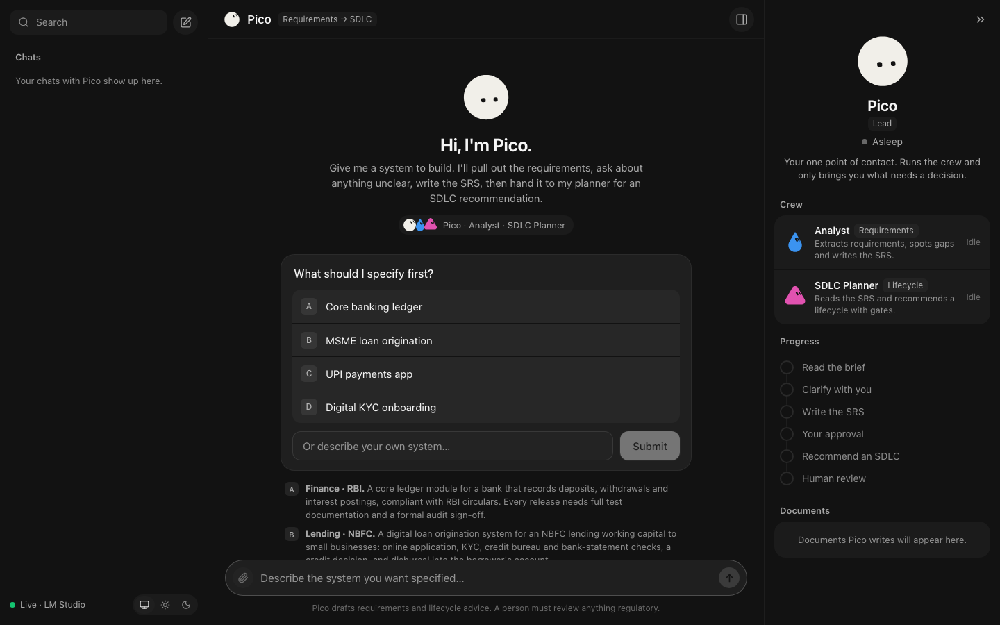

</div>

## What it does

Pico is a course project for software engineering. You chat with one assistant, Pico, and two AI agents do the work behind it:

1. The **Analyst** reads your brief, asks about anything unclear and writes a software requirements specification (SRS).
2. The **SDLC Planner** reads that SRS and recommends a development lifecycle, with a step-by-step workflow.

Everything runs on your own computer. The model runs in LM Studio, and Pico hides PAN, Aadhaar, card numbers, emails and phone numbers before any text reaches it.

## Features

<table>
<tr>
<td width="50%" valign="top">

### Clarifying questions
The Analyst asks 3 or 4 short questions, one card at a time. Each card has suggested answers, a box for your own answer and a Skip button. A skipped question becomes an open issue in the SRS.

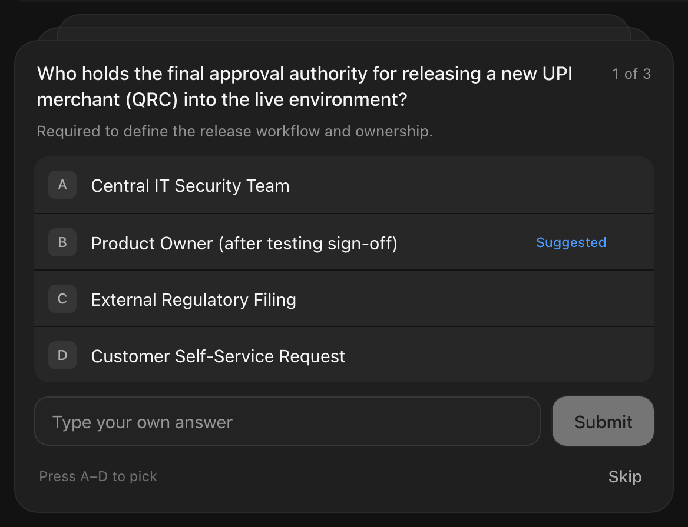

</td>
<td width="50%" valign="top">

### Requirements you can test
The SRS lists 8 to 10 requirements, each with a category, a priority and a measurable acceptance check. Pico numbers them, flags vague or repeated ones and links each one to a test case.

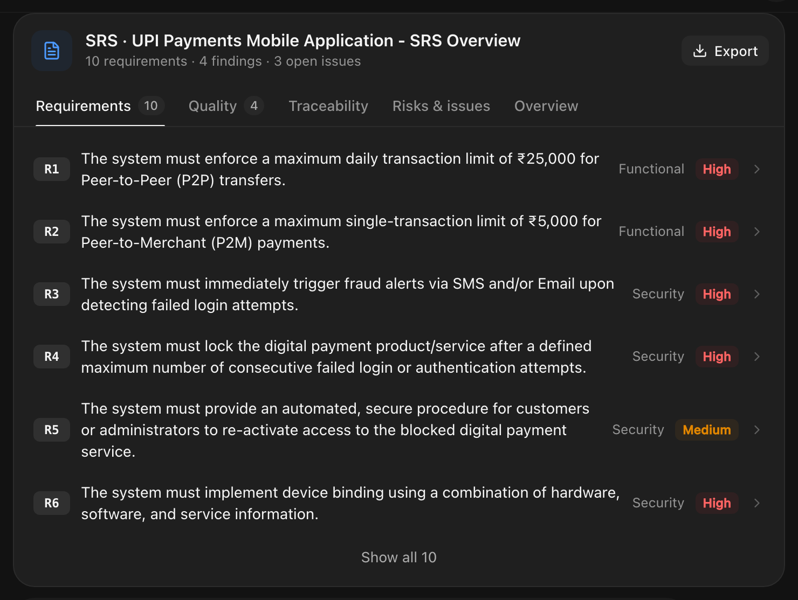

</td>
</tr>
<tr>
<td valign="top">

### Your approval before the hand-off
Pico stops and asks before it sends the SRS to the planner. Click Allow to continue, or Revise and type what to change, and the Analyst writes version 2.

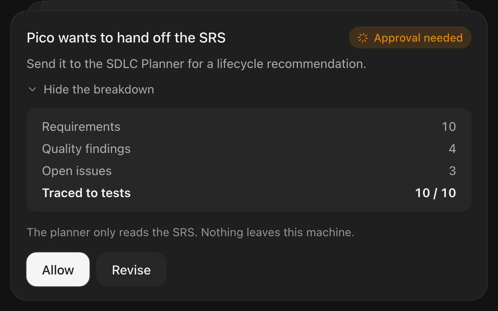

</td>
<td valign="top">

### SDLC recommendation
Pico scores seven lifecycles and explains the winner. Tabs show the full ranking, a workflow of 4 to 6 phases with exit gates, the 13 decision factors and why the other models lost.

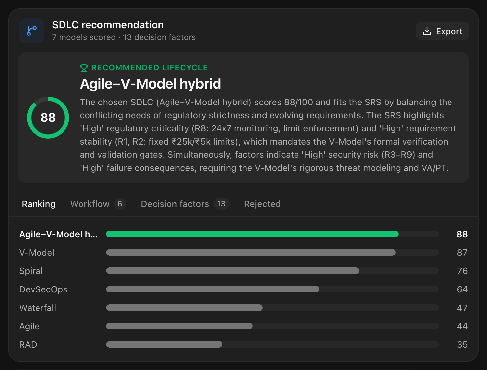

</td>
</tr>
<tr>
<td valign="top">

### Agent trace
Pico records every model call and document search. Click the steps link under an agent message to see how long each step took, how many tokens it used and what went in and out.

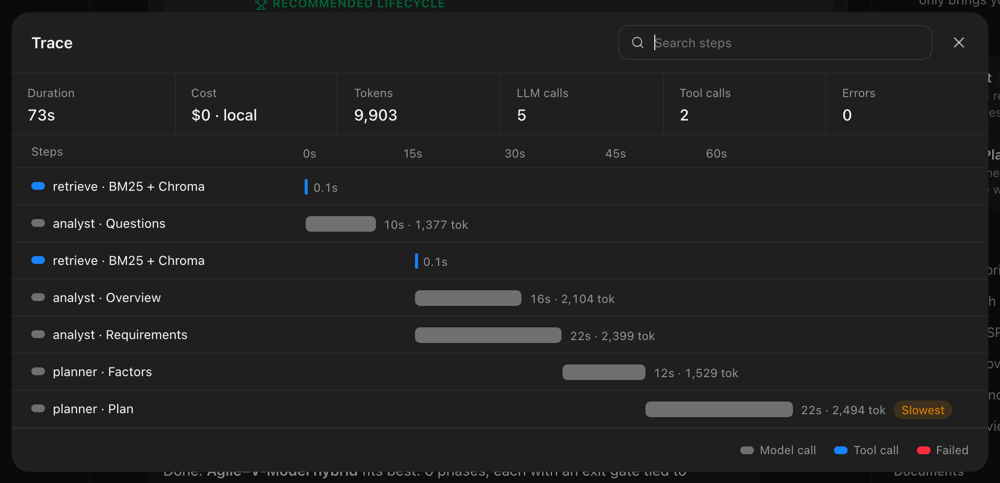

</td>
<td valign="top">

### Animated mascots
Pico, the Analyst and the SDLC Planner each have a mascot made with the [bloub](https://github.com/jeremy-prt/bloub) engine. A mascot blinks when idle, moves while its agent is working and winks when you hover over it.

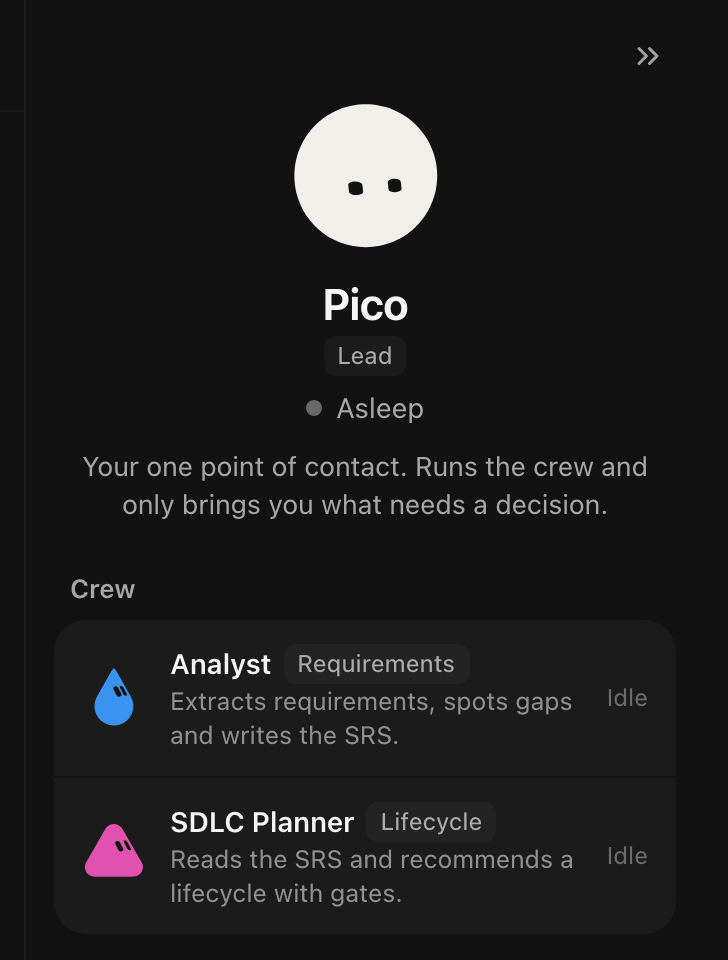

</td>
</tr>
</table>

## How it works

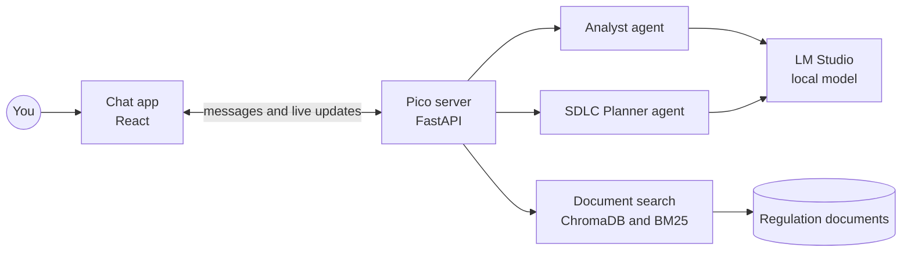

The chat app sends your brief to the Pico server. The server runs the two agents in order and pauses whenever it needs your answer or approval. Both agents are Google ADK agents that call a model running in LM Studio.

The diagram below follows one run in 14 numbered steps, including the loop back to the Analyst when you ask for changes.

<picture>
  <source media="(prefers-color-scheme: dark)" srcset="docs/diagrams/pico-agent-workflow-dark.png">
  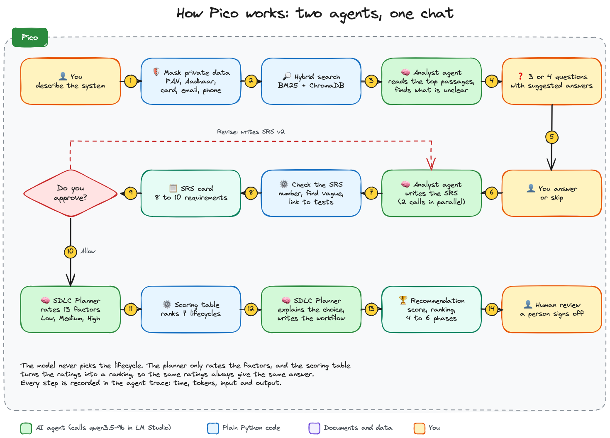
</picture>

The backend has three files:

| File | What it does |
|---|---|
| `backend/server.py` | Runs the conversation step by step and streams each update to the chat app. |
| `backend/agents.py` | Defines the two agents and the exact answer format each step must follow. |
| `backend/rules.py` | Holds the parts that need no model: masking, document search, SRS checks and SDLC scoring. |

### Document search (RAG)

Before each step, Pico searches 16 real documents for the passages that match your brief. They include RBI and SEBI rules, NIST and OWASP security guides and sample SRS documents from NASA and the World Bank. Pico runs two searches. Keyword search with BM25 finds exact terms such as "PAN" or "UPI", and ChromaDB finds passages with a similar meaning. Pico merges the two result lists and gives the agent the top passages. A requirement can only cite a passage that the agent actually received, and Pico marks any other citation as `NEEDS-VALIDATION`.

<picture>
  <source media="(prefers-color-scheme: dark)" srcset="docs/diagrams/pico-rag-dark.png">
  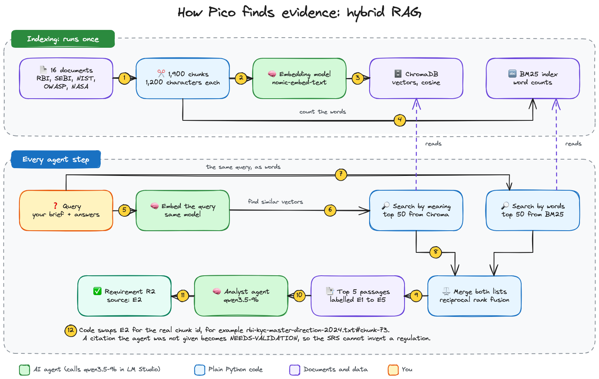
</picture>

### How the lifecycle is chosen

The SDLC Planner rates 13 factors as Low, Medium or High, such as regulatory pressure, security risk and how often the requirements will change. A fixed scoring table then scores Waterfall, V-Model, Spiral, Agile, DevSecOps, RAD and a hybrid of Agile and the V-Model. The model does not pick the winner, so the same ratings always give the same ranking. The planner only writes the explanation and the workflow.

## Use-case diagram

<p align="center">
  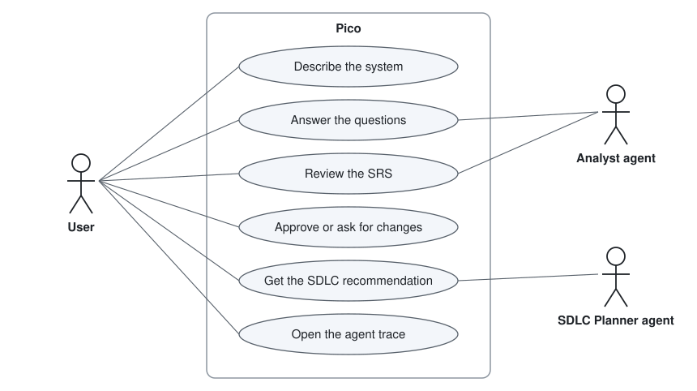
</p>

## Sequence diagram

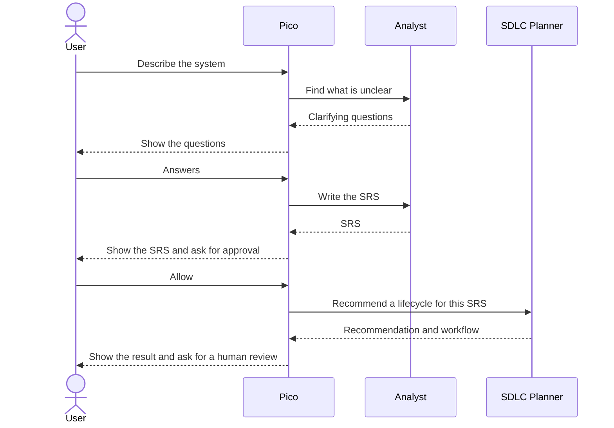

## Run it locally

You need [LM Studio](https://lmstudio.ai) with `qwen/qwen3.5-9b` and `text-embedding-nomic-embed-text-v1.5` downloaded, Python 3.12 with [uv](https://docs.astral.sh/uv/), and Node.js.

```bash
# 1. Start LM Studio and load both models
lms server start && lms load qwen/qwen3.5-9b && lms load text-embedding-nomic-embed-text-v1.5

# 2. Start the backend
cd backend
uv venv --python 3.12 .venv && uv pip install --python .venv/bin/python -r requirements.txt
.venv/bin/uvicorn server:app --port 8000

# 3. Start the chat app in a second terminal, then open http://localhost:5190
cd frontend && npm install && npm run dev
```

The first search takes about 30 seconds because Pico stores the documents in ChromaDB once. To change the LM Studio address or the models, copy `backend/.env.example` to `backend/.env` and add `--env-file .env` to the uvicorn command. To try the app without a model, run `VITE_AGENT=mock npm run dev` for a scripted demo.

The API and more backend details are in [`backend/README.md`](backend/README.md).

## Project structure

```
backend/     server.py, agents.py, rules.py and the corpus/ of documents
frontend/    the React chat app; src/bloub/ is the mascot engine
docs/        screenshots and diagrams; docs/diagrams/ has the Excalidraw files
```


> [NOTE] <br />
> Pico writes drafts. A qualified person must check any reading of a regulation, the final requirements and the choice of lifecycle.
